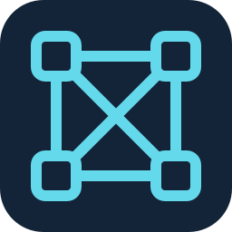

# Automation Control Plane for VS Code

Private compatibility fork for Action Packages, Robot Tasks, Work Items and inspectors using published joshyorko RCC and Actions tooling.

- [Extension usage and private VSIX installation](./sema4ai/README.md)
- [Feature acceptance ledger and verified compatibility findings](./docs/compatibility-port.md)
- [Development](./docs/develop.md)
- [Private issue tracker](https://github.com/automation-control-plane/automation-vscode/issues)

The extension ID is `automation-control-plane.automation-vscode`. This candidate remains under qualification; see the ledger for executed checks and open gates.

Derived from the Sema4.ai / Robocorp extension under Apache-2.0. See [LICENSE](./LICENSE), [COPYRIGHT](./COPYRIGHT) and [third party notices](./ThirdPartyNotices.txt).
